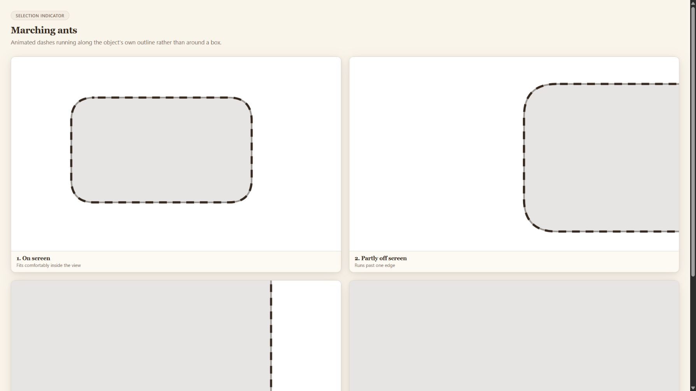

# bound.less Selection Feedback Lab

An interactive design study of selection feedback on an infinite canvas, where an object may be smaller than a pixel, thinner than its outline, or larger than the whole viewport.



## Run

```sh
python -m http.server 8000 --bind 127.0.0.1
```

Open http://127.0.0.1:8000. Start with the scene overview, then compare marching ants, a clamped frame, corner ticks, object shimmer, and tint/edge marks. The stripped-down ant page isolates geometry from the rest of the interface.

## Design question

A conventional bounding box loses meaning when all its corners are outside the viewport. A thick highlight can obscure a tiny mark, while a faint outline can disappear against the drawing. The experiments apply alternative indicators to shared scenes so the tradeoffs can be compared directly.

The pages explore feedback presence, coverage, visual weight, motion and scale. They are concept prototypes, not a shipped component library or an accessibility certification. Motion and contrast should be evaluated with users and the actual drawing background before choosing a production design.

## Portfolio contribution

This complements the bound.less renderer with product judgment: translate a difficult geometry constraint into understandable interaction alternatives, then make those alternatives easy to inspect. AI assisted the prototyping process; no model runs inside the demo.

The portfolio copy adds a landing page and removes optional network font imports so the experiments work locally. Existing scene geometry remains intact. Static references and JavaScript syntax are checked, and the live page is inspected in Chrome. [Publication review](PUBLICATION_REVIEW.md).
